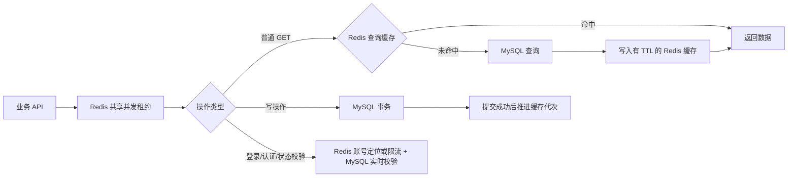

# Redis API 数据路径

Redis 与 MySQL 由应用服务编排。Redis 不代替 SQL 数据库，也不直接替应用查询 MySQL。

所有使用 `withRequestCapacity` 的业务 Route 共用 Redis 入口。`/api/health` 独立于该入口，
使 Redis 故障时仍能取得分项诊断。文件、Range 和 SSE 只使用并发租约，不把文件流或连接缓存为 JSON。

登录先查 Redis 中的用户名→账户 ID 定位信息，未命中从 MySQL 加载。密码哈希、安全答案、
Cookie 和重置凭证不进入查询缓存；每次登录仍从 MySQL 读取当前密码、封禁、删除和会话版本。
因此改密、封禁或注销后的旧缓存不能继续授予权限。安全问题查询保留公开展示产品行为，
增加目标及来源限流；该行为仍会暴露有效账户的找回问题，不能声称彻底消除账户枚举。

查询缓存目前覆盖 Hero、Equipment、RolePreference、HeroPower、Announcement 的普通 GET，
TTL 为 30 秒、单条编码后最大 1 MiB。缓存键包含数据库连接配置的摘要、查询参数和缓存代次；
不同用户的数据查询必须包含其用户 ID。Date、BigInt、Decimal 和业务 JSON 可往返保留类型。
账户、权限、房间状态、比赛状态及所有事务读直接使用 MySQL。写请求中的校验查询也直接回源。

写入在 MySQL 成功后推进缓存代次；事务在 commit 后推进。慢旧查询仍只填充旧代次，
不能污染新缓存。Redis 失效通知失败或外部程序直接写库时，普通数据缓存可能继续存在至 TTL 到期；
它不提供跨数据库和 Redis 的原子一致性。权限与安全状态始终使用当前 MySQL 值。

共享并发额度复用 `RESOURCE_EXTERNAL_CONCURRENCY` 和 `RESOURCE_SUBSCRIPTION_CONCURRENCY`。
Redis Lua 原子取得额度，请求/流结束时释放；30 秒续租，进程崩溃后的租约最多存活约 90 秒。
认证尝试限流也先使用 Redis Lua，避免计数的读写竞态。

Compose 固定 `REDIS_REQUIRED=1`：Redis 入口不可用时业务请求返回 `503 REDIS_UNAVAILABLE`，
健康端点继续报告依赖故障。原生开发保留 `REDIS_REQUIRED=0`：缓存或 Redis 限流失败时可回源
MySQL；数据库限流继续作为降级路径。恢复 Redis 后不会自动迁移两套限流计数，可能获得一个新的
受限窗口，因此敏感生产实例应使用 required 模式。Redis 使用 noeviction 时，容量满也需要实际故障演练。

直接 LAN 模式默认不信任客户端 X-Real-IP。Next Route 无可靠 socket 来源时，IP 维度退到共享桶，
账号维度限流仍存在。需要区分 LAN 客户端时，应通过受控网关覆盖 X-Real-IP、限制 Web 直连，
再显式设置 TRUST_PROXY=1。生产模式的默认信任仍要求唯一受控代理拓扑。

开发验证入口：`npm run test:audit-repairs`。真实 Redis 的原子并发与缓存合同入口为
`npm run test:redis:audit`，只接受显式允许的本机 Redis DB 15；真实 MySQL 回归入口为
`npm run test:integration:audit`，只接受明确隔离的 `_ci`/`_test` 库。后两者已接入 CI，
本机没有相应服务时不能把前者的测试替身当作真实服务验收。

实现依据：[Redis 官方 Cache-aside](https://redis.io/docs/latest/develop/use-cases/cache-aside/)。
