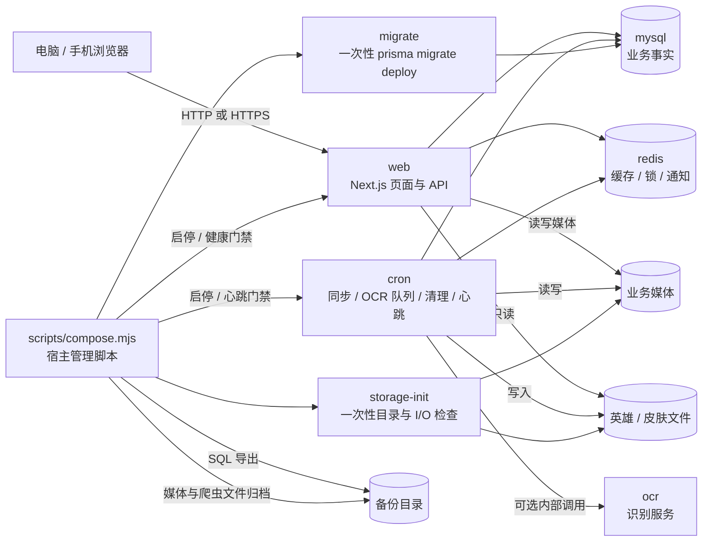
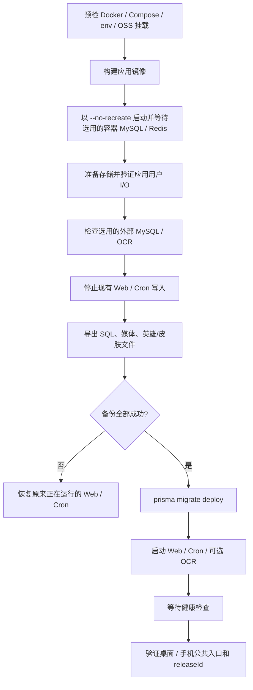

# Docker Compose 运行架构

本文说明容器部署时各组件的职责、依赖关系、数据归属和故障边界。实施操作以 [Docker Compose 部署与运维手册](../operations/docker.md) 为准；代码目录依赖以 [代码分层架构](code-architecture.md) 为准。

## 1. 运行拓扑



只有 `web` 发布宿主端口。容器 MySQL、Redis 和 OCR 使用 Compose 私有网络。`MYSQL_MODE=container|external` 选择容器或已有数据库；`OCR_MODE=off|container|external` 选择关闭、容器或已有识别服务。两项独立选择，Redis 仍使用容器。已有 Nginx 继续负责宿主反向代理，公网模式 Web 绑定 `127.0.0.1`。

外部服务地址由实施人员填写；同机服务使用 `host-machine`（`host-gateway` 映射），不能填容器自身的回环地址。管理脚本自动选择 profiles、派生内部地址并在停写前探测外部连接。原生回环 OCR 的宿主 Nginx 代理接入步骤见 [部署手册 2.5 节](../operations/docker.md#25-复用同机-mysqlnginxocr-的最小配置)。

配置由宿主脚本解析并复用，`compose.yaml` 只声明服务拓扑、网络、挂载、依赖和探针：

- [compose.mjs](../../scripts/compose.mjs) 调用 [compose-runtime.mjs](../../scripts/compose-runtime.mjs)，从同一 `.env.docker` 生成各角色环境、容器资源限额及 MySQL/Redis 启动参数。
- [runtime-env.mjs](../../docker/runtime-env.mjs) 同时供部署脚本和容器入口调用，统一应用变量白名单、容器连接/路径与凭据派生；MySQL root 密码只传给数据库容器。
- [resource-settings.ts](../../src/core/resource-settings.ts) 保留调度和 Worker 的默认值及校验，YAML 不再抄写这些默认值。
- [runtime-command.mjs](../../scripts/runtime-command.mjs) 供 Docker 入口和原生 PM2 直接调用，统一 Web/Cron 的实际 Node 启动命令，Cron 保持在受监督的进程中运行。

管理脚本通过 Compose 的 `-f -` 从标准输入传入本次 JSON 配置，按“基础拓扑 → 可选 OSS 挂载 → 运行配置”合并；基础文件仍是相对路径基准。配置只在进程内生成，不落地第二份密钥文件，也不进入命令参数。输入转义与 `config` 输出解码保留凭据中的字面 `$`。机制见 [Compose CLI](https://docs.docker.com/reference/cli/docker/compose/) 和 [多文件合并](https://docs.docker.com/compose/how-tos/multiple-compose-files/merge/)。

`compose.yaml` 的内部入口检查由管理脚本自动满足，不需要新增环境配置。`status/logs/down` 不依赖运行参数生成，连接地址或资源参数填写错误时仍可维护已有容器。原生发布与容器发布各自管理生命周期，共用应用命令和策略；容器入口不执行宿主 PM2/systemd 发布流程。

## 2. 服务职责

Web 和 Cron 内置同一自适应资源策略，通过业务库交换压力摘要并竞争共享重任务租约。容器内存/CPU 上限和入口存活监督器提供最后保护，详细配置与恢复步骤见 [资源调度与自动恢复](../operations/resource-governor.md)。

普通 API 与实时订阅分别限流、分别计数。高压优先收缩内部任务和订阅，空闲页面缓存、失败空条目与闲置分队线程进入回收；正在加载的缓存、有效租约和执行中的分队线程受保护。自身内存持续危急时停止接收新业务，结束可重连订阅并进入有期限的优雅退出。

所有托管常驻服务及一次性工具均设置内存/CPU/PID 边界。管理脚本在构建和停写前核对 Docker 实际可见内存、所选服务限额、一次性任务与宿主/外部服务预留；数据服务继续使用 `--no-recreate`，旧容器真实限额不符时停止发布并要求资源维护。MySQL/Redis 活动数据归属和 OSS 边界保持下文约定。

| 服务 | 生命周期 | 职责 | 持久化 |
| --- | --- | --- | --- |
| `web` | 常驻 | 桌面/手机页面、API、登录和媒体访问 | 读写媒体；只读英雄/皮肤文件 |
| `cron` | 常驻且单实例 | 数据同步、英雄/皮肤下载、OCR 队列、过期任务、清理和心跳 | 写 MySQL/Redis、媒体和英雄/皮肤文件 |
| `mysql` | 容器模式常驻，外部模式不启动 | 用户、赛事、任务状态、爬虫结构化结果等业务事实 | `mysql-data` 本地 Docker 卷或已有 MySQL 存储 |
| `mysql-client` | 外部数据库的一次性客户端 | 停写前查询连接、导出选定业务库，不启动数据库服务器 | 不挂载数据库数据目录 |
| `redis` | 常驻 | 缓存、分布式锁和通知 | `redis-data` 本地 Docker 卷，开启 AOF |
| `storage-init` | 一次性 | 创建目录并以应用用户验证写入、重命名和读回 | 不保存独立状态 |
| `migrate` | 一次性 | 执行 `prisma migrate deploy` | 变更 MySQL schema |
| `ocr` | 选择 container 时常驻 | 内部 OCR 辅助识别；external 时调用已有服务 | 容器模型随镜像；业务结果写 MySQL/媒体 |

Web 和 Cron 使用相同应用镜像，以 uid/gid `1000:1000` 运行。命名卷模式下，`storage-init` 先准备目录属主，再降权验证 I/O；rclone 模式下直接以 uid/gid 1000 验证 I/O，不对 FUSE 挂载执行 `chmod/chown`。

## 3. 数据归属

| 数据 | 权威位置 | 是否进入备份 | 恢复说明 |
| --- | --- | --- | --- |
| 业务表、用户、赛事、爬虫结构化结果、任务状态 | MySQL `mysql-data` 卷或外部业务库 | `database.sql` | 恢复时必须匹配 schema/release |
| Redis 缓存、锁、通知 | Redis `redis-data` 卷 | 否 | 可由应用重新建立；不是业务事实来源 |
| 截图、视频、头像 | 命名卷或 `<OSS_DATA_PATH>/media` | `media.tar.gz` | OSS 模式下是主要业务文件位置 |
| Cron 英雄与皮肤文件、来源记录 | 命名卷或 `<OSS_DATA_PATH>/heroes` | `hero-assets.tar.gz` | 可重新同步，但备份保留当时一致快照 |
| 环境密钥 | 宿主 `.env.docker` | 不自动备份 | 必须存入独立的私密凭据保管位置 |
| SQL、媒体、爬虫文件备份 | 默认本地目录或 `COMPOSE_BACKUP_DIR` | 本身即备份集 | `manifest.json` 记录写入完成状态 |
| rclone 配置与 OSS 凭据 | 宿主 rclone 配置 | 不进入容器 | 由服务器运维独立管理 |

MySQL 活动数据文件不直接放到 OSS/FUSE。容器数据库使用本地 Docker 卷，外部数据库保留已有本地存储；通过 SQL 导出把选定业务库备份写入 OSS。外部模式使用现有专用账户和短时客户端，不要求提供 root 密码；账户需具有迁移和完整导出的权限。模式切换不会自动迁移数据。

## 4. 两种存储模式

### Docker 命名卷

`STORAGE_MODE=volume` 是默认模式。媒体、英雄和皮肤文件使用 Compose 命名卷，适合开发机、单机和未接入 OSS 的环境。`down` 保留这些卷。

### rclone / OSS

`STORAGE_MODE=rclone` 时，管理脚本自动叠加 `compose.oss.yaml`：

- `<OSS_DATA_PATH>/media` 绑定到 `/app/data/media`；
- `<OSS_DATA_PATH>/heroes/images` 绑定到 `/app/public/heroes/images`；
- `<OSS_DATA_PATH>/heroes/skins` 绑定到 `/app/public/heroes/skins`；
- `COMPOSE_BACKUP_DIR` 由宿主管理脚本直接写入，不暴露给 Web；
- Web 对英雄/皮肤目录只读，Cron 和 storage-init 可写；
- Docker 禁止自动创建绑定源目录，避免挂载缺失时写入本地同名目录。

管理脚本和应用容器都会检查 `fuse.rclone`。部署、同步和备份在挂载缺失、路径逃逸或嵌套到本地文件系统时停止。

## 5. 启动与更新顺序



构建失败不会停止现有应用。备份失败不会执行 migration，并尝试恢复更新前正在运行的 writer。migration 开始后的失败会保持 Web/Cron 停止，保留备份和现场，不自动反向迁移或导入旧 SQL。

## 6. 健康与暴露边界

- Web 健康检查调用 `/api/health`，要求响应成功并匹配 `APP_RELEASE_ID`。
- Cron 健康检查要求当前容器启动后产生当前 release 的新心跳；旧心跳不能掩盖启动失败。
- 容器 MySQL 与 Redis 使用容器内健康检查；外部 MySQL 使用容器网络查询检查，外部 OCR 检查健康与六图协议。应用在依赖、存储检查和 migration 成功后启动。
- `restart: unless-stopped` 负责进程退出后的重启；Docker 不会只因状态为 `unhealthy` 自动重启容器。
- 公网部署由宿主反向代理终止 HTTPS；Compose 不管理域名、证书或防火墙。

## 7. 备份边界

每个完成的备份目录包含：

```text
database.sql
media.tar.gz
hero-assets.tar.gz
manifest.json
```

`manifest.json` 的 `complete: true` 只证明上述文件已写入目标文件系统。rclone 可能仍在把 VFS 缓存写回 OSS，因此 `remoteUploadVerified: false` 会一直保留；实施人员需从 OSS API、控制台或远端 `rclone lsf/check` 核验远端对象。

业务文件和备份放在同一 OSS 账号或存储桶时，可以应对云服务器本地磁盘故障，但不能应对 OSS 账号误删、凭据泄漏或存储桶级故障。需要独立灾备时，应在 OSS 侧启用版本控制/保留策略，或把备份复制到独立存储桶、账号或区域。

## 8. 配置和变更边界

- `.env.docker` 不提交仓库；首次生成后保留现有密钥。
- 已初始化 MySQL 后，修改 env 中的数据库用户名或密码不会修改数据库内部账户。
- 普通应用更新不替换 MySQL/Redis 容器；数据服务升级是独立维护任务。
- 外部模式不管理已有 MySQL/OCR 的进程；备份只覆盖配置的业务库，迁移期间其他写入者需独立暂停。健康检查不证明 OCR 令牌或识别准确率，必须实际上传六图验收。
- 生产 schema 只使用 `prisma migrate deploy`，不使用 `db push`。
- `down` 不删除卷；管理脚本拒绝 `--volumes` 等额外破坏性参数。
- PM2 原生部署和 Compose 是两条独立部署路线，同一实例不要混用进程管理和数据目录。
